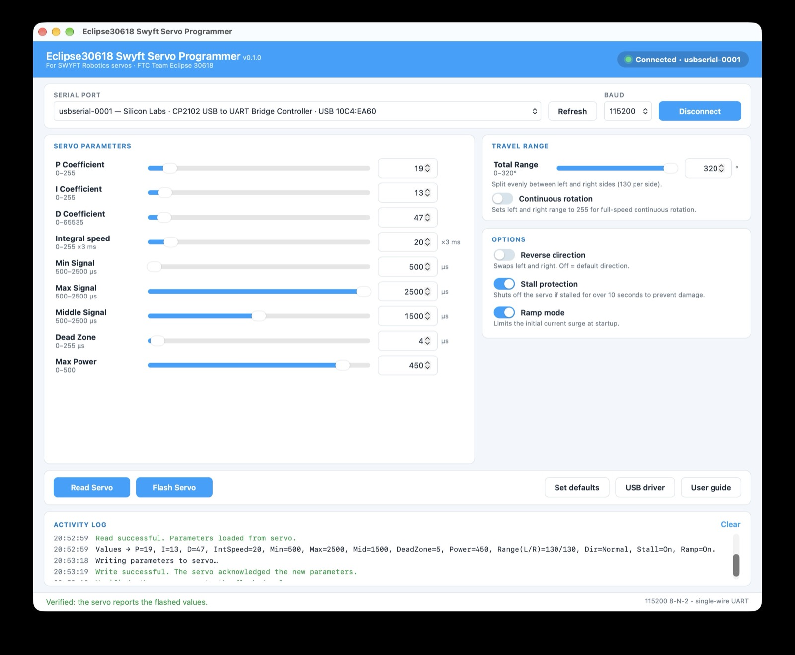

# Eclipse30618 Swyft Servo Programmer

Read and flash SWYFT servo settings from **macOS, Windows or Linux**. Built by FTC Team Eclipse 30618.

This is a cross-platform port of SWYFT Robotics'
[SWYFT Servo Programmer V2](https://github.com/SWYFT-Robotics/swyft-servo-programmer-v2) (Windows only).
It uses the same protocol, parameters and defaults.



## 1. Download

Get the installer for your computer from the [Releases](../../releases) page:

| Platform | File |
|----------|------|
| macOS (Intel + Apple Silicon) | `.dmg`: the app isn't notarized, so on first launch right-click → **Open** |
| Windows | `.msi` or `-setup.exe` |
| Linux | `.deb`, `.rpm` or `.AppImage` |

## 2. Get the parts

**Easiest:** buy SWYFT's official servo programmer
([SWYFT Robotics store](https://swyftrobotics.com/electrical/swyft-servos?variant=49812010631462)). It's
pre-wired, so plug the servo into it and skip to [step 4](#4-driver).

**Build your own:**

- **USB-to-UART dongle:** CP2102 "HW-598A" board ([Amazon](https://www.amazon.com/dp/B00LODGRV8))
- **1 diode:** 1N4148 or 1N5819
- **1 resistor:** 4.7 kΩ

## 3. Wire it up (build your own only)

```
                 +5V
                  │
                 4.7 kΩ  (pull-up)
                  │
  RXD ────────────●──────────── Servo signal
                  │
                diode (1N4148 / 1N5819), stripe (cathode) toward TXD
                  │
  TXD ────────────┘

  +5V ───────────────────────── Servo V+   (dongle 5V or Control Hub +5V)
  GND ───────────────────────── Servo GND  (must be shared with the dongle)
```

> On this 3.3 V dongle, a plain 1 kΩ resistor between TX and RX does **not** work. Use the diode
> and pull-up shown above.

If you power the servo from a Control Hub servo port, connect only the port's +5 V and GND. Leave
the hub's signal pin disconnected.

### Simpler option: a 5 V logic dongle

The diode and pull-up are only there because the HW-598A uses 3.3 V logic and the servo expects 5 V.
A dongle with **5 V logic** (many have a 3.3V/5V jumper, which you set to 5V) skips the pull-up.
Wire RXD straight to the servo signal, and connect TXD to the signal through a 1 kΩ resistor.
Share GND as above.

> We haven't tested this simpler wiring yet. If the servo doesn't answer, use the diode setup above,
> which is confirmed working.

## 4. Driver

- **Windows:** install the [Silicon Labs CP210x driver](https://www.silabs.com/developer-tools/usb-to-uart-bridge-vcp-drivers)
  once. The app's **USB driver** button opens the same page.
- **macOS:** nothing to install.
- **Linux:** add yourself to the `dialout` group (`uucp` on Arch), then log out and back in.

## 5. Use it

1. Plug in the dongle. The app finds it and reads the servo automatically.
2. Edit the settings. Fields you changed are highlighted.
3. Click **Flash Servo** (`Ctrl/⌘+Enter`). The app reads the servo back to confirm the write.

**No reply?** The servo sometimes ignores the first request after power-up, so click
**Read Servo** (`Ctrl/⌘+R`) again. If it still doesn't answer, check the diode direction and the shared ground.

## Development

Requirements: Node.js, Rust, and the [Tauri 2 prerequisites](https://v2.tauri.app/start/prerequisites/)
(on Linux, also `libudev-dev`).

```bash
npm install
npm run icons          # generate the icon set (once)
npm run tauri:dev      # run with hot reload
npm run tauri:build    # build installers for this OS

cd src-tauri
cargo test --lib                  # protocol unit tests
cargo run --example servo_check   # list ports + one read (never writes)
cargo run --example listen        # wiring diagnostics: echo, stray bytes, replies
```

### Releasing

Push a version tag, for example `git tag v0.1.0 && git push origin v0.1.0`. GitHub Actions builds
the installers for all three platforms and publishes the release once every installer is present.

## License

MIT. See [LICENSE](LICENSE). Based on
[SWYFT Servo Programmer V2](https://github.com/SWYFT-Robotics/swyft-servo-programmer-v2)
© SWYFT Robotics (MIT, see [LICENSE-SWYFT](LICENSE-SWYFT)).
